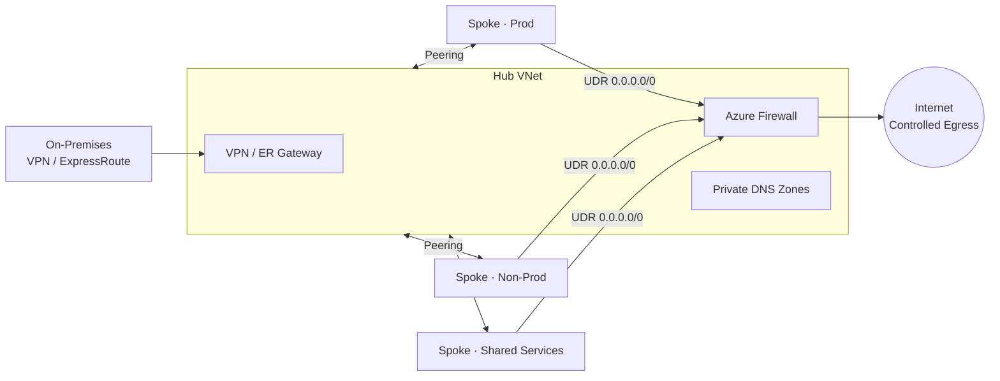
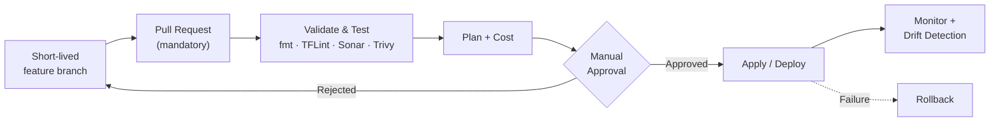

<div align="center">


[](https://github.com/cloudwithdharm)

<p>
  <a href="https://www.linkedin.com/in/dharmendra-prasad92"></a>
  <a href="mailto:dharmendraprasad708@gmail.com"></a>
  
  
</p>

</div>

---

## 👋 Hi, I'm Dharmendra

I'm a **Senior DevSecOps Engineer** with **9+ years in IT**, including **6+ years in Cloud, DevOps and DevSecOps**, currently at **AmeriCloud**, Hyderabad.

My journey: **telecom & networks** (Ericsson, Nokia) → **cloud automation** → **DevSecOps** → **platform engineering and technical leadership**. Starting in networking shaped how I design cloud: connectivity, segmentation, inspection and resilience come first, not as an afterthought.

Today I design and run **enterprise Azure platforms**: governed tenants, hub-and-spoke networks, Terraform landing zones and secure delivery pipelines that teams can trust.

> 💡 **How I think:** *Everything as code. Security shifted left. Governance by default. Automate the repeatable so people can focus on the hard problems.*

<table>
<tr>
<td width="50%">

**🔭 What I work on**
- Azure Landing Zones & Management Groups
- Terraform automation & reusable modules
- Secure CI/CD (Azure DevOps, GitHub Actions)
- Kubernetes (AKS) & containers
- Cloud migration, FinOps, DR & observability

</td>
<td width="50%">

**⚡ What I've delivered**
- **80% faster** infrastructure provisioning via Terraform
- Consistent **Dev → UAT → Prod** deployments
- Security scanning embedded in pipelines
- **RBAC** and least-privilege access models
- Vendor, KT and team upskilling leadership

</td>
</tr>
</table>

---

## 🛠️ Tech Stack

<div align="center">

**☁️ Cloud & Infrastructure as Code**


**🔁 CI/CD & Source Control**


**📦 Containers & Orchestration**


**🔐 Security & DevSecOps**


**📊 Monitoring & Observability**


**💻 OS & Scripting**


</div>

---

## 🏛️ Enterprise Azure Platform Engineering

### 🧱 Tenant, Management Groups & Governance

A clean hierarchy is the backbone of governance. Policy and access flow **down**, and exceptions are always explicit.


- Platform vs application **subscription design** and tenant boundaries
- **Azure Policy & initiatives** at management group scope
- **RBAC group model**: access through groups, never individuals
- **Subscription onboarding / offboarding** process
- **Policy exemptions** with written justification
- Identity governance in Entra ID, with **Defender for Cloud**

### 🧭 Cloud Adoption Framework (CAF)
Programs aligned to the CAF lifecycle: **Strategy → Plan → Ready → Adopt → Govern → Secure → Manage**.

### 🌐 Hub-and-Spoke Networking
**Centralized inspection · Shared connectivity · Controlled egress**



- **IPAM & CIDR planning**, including on-premises CIDR assessment to prevent overlap
- **UDRs**, firewall rules, **Private Endpoints**, **Private DNS zones**
- **VPN Gateway & ExpressRoute** for hybrid connectivity

### 🛡️ Security at Every Layer

| Layer | What I enforce |
|---|---|
| 🪪 **Identity** | Entra ID, group-based RBAC, least privilege |
| 🌐 **Networking** | Hub firewall, NSGs, UDRs, Private Endpoints |
| 📜 **Governance** | Management groups, Azure Policy, initiatives |
| 🖥️ **Compute** | Hardening, Defender, patching, vulnerability management |

### 🏗️ Terraform Landing Zone Automation
- **Remote state** with least-privilege access and **encryption at rest**
- **Versioned reusable modules**
- Pipeline gates: **linting · secret scanning · testing · cost estimation**
- **Manual approvals** before apply and **drift detection** via scheduled pipelines

```hcl
# My standard: remote state, locked down, no access keys
terraform {
  backend "azurerm" {
    resource_group_name  = "rg-tfstate-platform"
    storage_account_name = "sttfstateplatform"
    container_name       = "tfstate"
    key                  = "landingzone/prod.tfstate"
    use_azuread_auth     = true
  }
}
```

### 🔁 Secure Pipelines & Branching Strategy



- **Trunk-based** branching, PRs mandatory, **no delete on `main`**, **CODEOWNERS**, minimum reviewers
- Reusable templates: **Validate & Test → Build → Deploy → Apply → Rollback**, with **parallel jobs**

### 🚚 Cloud Migration · 💰 FinOps · ♻️ DR · 📈 Observability

| Area | Focus |
|---|---|
| 🚚 **Migration** | Assess → Discover → Readiness → Cutover → Hypercare, with pre / during / post checklists |
| 💰 **FinOps** | Idle resources, unattached disks, oversized VMs, log ingestion, VM auto-shutdown, reserved capacity, backup retention |
| ♻️ **DR & HA** | LRS / ZRS / GRS, VMSS, primary + secondary regions, RTO / RPO driven design |
| 📈 **Observability** | Azure Monitor, Log Analytics, alerting, Prometheus & Grafana |

---

## 🤝 Technical Leadership & Vendor Management

Beyond hands-on engineering, I lead the delivery side too:

| | |
|---|---|
| **Vendor lifecycle** | RFI / RFP, technical evaluation matrix, commercial proposals, SOW |
| **Delivery control** | Scope, deliverables, acceptance criteria, sprints, dependencies, risks, payment milestones |
| **Cadence** | Weekly reviews, retro calls, deliverable sign-off, escalation matrix |
| **Transitions** | Knowledge transfer, documentation handover, RACI |
| **People** | Team management, upskilling strategy, senior-level interviews |

---

## 💼 Experience

| Period | Role | Company |
|---|---|---|
| **May 2024 – Present** | **Senior DevSecOps Engineer** | **AmeriCloud**, Hyderabad |
| Mar 2022 – May 2024 | DevOps & Security Engineer | CEMtics Solution, Gurgaon |
| Apr 2021 – Feb 2022 | Cloud & Automation Engineer | Ericsson Global India |
| 2017 – 2021 | Network & IT Support Engineer | Ericsson · Nokia · Teleysia Network |

## 📌 Featured Projects

| Project | Stack | What it covers |
|---|---|---|
| **Azure Infrastructure Automation** | Terraform · Azure · Linux · Git | Modular IaC for VNets, subnets, NSGs, storage and VMs with remote state and CI/CD |
| **Secure CI/CD Pipeline** | Azure DevOps · GitHub · Terraform · SonarQube | Automated pipelines with code quality and security validation gates |
| **Kubernetes Deployment on AKS** | Docker · AKS · ACR | Containerized apps with scaling and monitoring |

---

## 📊 GitHub Stats

<div align="center">


</div>

---

## 🎓 Education & Certification

- 🎓 **B.Tech**, Electronics & Communication Engineering
- ☁️ **AWS Cloud**, Ethans Tech (ISO Certified), Jan 2021

## 🌱 Currently

- 🔨 Building reusable Terraform modules and Azure landing zone patterns
- 📚 Deepening DevSecOps automation and platform governance
- 💬 Open to conversations on Azure architecture, Terraform and DevSecOps

---

<div align="center">

### 📫 Let's Connect

[](https://www.linkedin.com/in/dharmendra-prasad92)
[](mailto:dharmendraprasad708@gmail.com)

*"Automate everything. Secure by default. Govern at scale."* ☁️


</div>
