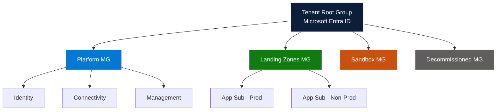
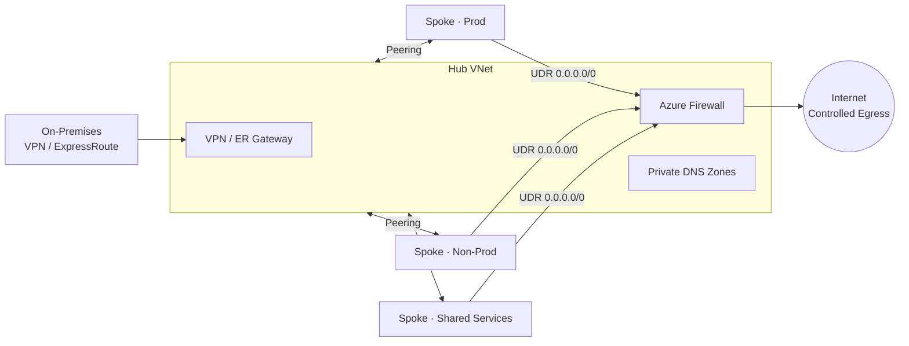
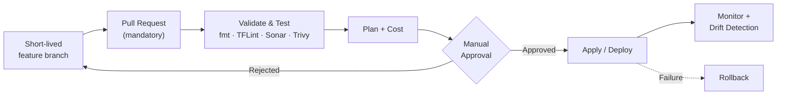
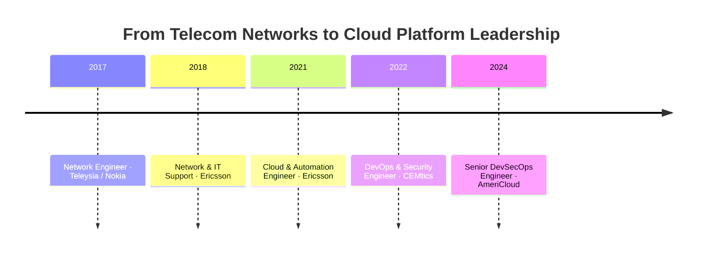

<div align="center">


[](https://github.com/cloudwithdharm)

<br/>


<a href="https://www.linkedin.com/in/dharmendra-prasad92"></a>
<a href="mailto:dharmendraprasad708@gmail.com"></a>


</div>

<br/>

## 🧭 Who I Am

I'm a **Senior DevSecOps Engineer at AmeriCloud** who builds the **foundation other teams build on**: governed Azure tenants, hub-and-spoke networks, Terraform landing zones and secure delivery pipelines.

My career started in **telecom and network engineering** (Ericsson, Nokia), so I think about cloud the way a network engineer does: **connectivity, segmentation, inspection and resilience first**. That is why my platforms are secure and predictable in production.

> **I don't just deploy resources. I design operating models:** how subscriptions are organised, how access is granted, how code reaches production, and how cost, security and recovery are controlled.

<br/>

## ⚡ Impact at a Glance

| 🚀 Delivery | 🔐 Security | 🏛️ Governance | 🤝 Leadership |
|:---:|:---:|:---:|:---:|
| **80% faster** infrastructure provisioning with Terraform | Security scanning built into every pipeline | Management groups, Policy and RBAC by design | Vendor management, KT and team upskilling |
| Consistent **Dev → UAT → Prod** | **RBAC** and least-privilege access | Policy exemptions with justification | SOW, RFP/RFI and deliverable sign-off |

<br/>

## 🛠️ Tech Arsenal

<div align="center">

<a href="https://skillicons.dev"></a>

</div>

<table>
<tr>
<td width="50%" valign="top">

**☁️ Cloud Platform**
`Azure` `Entra ID` `VNet` `Load Balancer` `Application Gateway` `Azure Firewall` `Key Vault` `Storage` `ACR` `AKS`

**🏗️ Infrastructure as Code**
`Terraform` `ARM Templates` `Reusable Modules` `Remote State`

**🔁 CI/CD**
`Azure DevOps` `Azure Pipelines` `GitHub Actions` `Jenkins`

</td>
<td width="50%" valign="top">

**🔐 DevSecOps**
`SonarQube` `Trivy` `TFLint` `OWASP` `RBAC` `Defender` `Azure Policy` `Vulnerability Mgmt`

**📦 Containers**
`Docker` `Kubernetes (AKS)` `Helm`

**📊 Observability**
`Azure Monitor` `Log Analytics` `Prometheus` `Grafana`

**💻 Systems & Scripting**
`Linux` `Windows Server` `Bash` `PowerShell` `Python`

</td>
</tr>
</table>

<br/>

## 🏛️ Enterprise Azure Platform Engineering

*Expand any area to see how I approach it.*

<details open>
<summary><b>🧱 1 · Tenant, Management Groups & Governance</b></summary>
<br/>

A clean hierarchy is the backbone of governance: policy and access flow **down**, and exceptions are explicit.



- Subscription boundaries: **platform** vs **application** subscription design
- **Azure Policy & initiatives** assigned at management group scope
- **RBAC group model**: access via groups, never individuals
- **Subscription onboarding / offboarding** runbooks
- **Policy exemptions** with written justification and expiry
- **Defender for Cloud**, user and group lifecycle in Entra ID

</details>

<details>
<summary><b>🌐 2 · Hub-and-Spoke Networking</b></summary>
<br/>

**Centralized inspection · Shared connectivity · Controlled egress**



- **IPAM & CIDR planning**, including on-premises CIDR assessment to prevent overlap
- **UDRs**, firewall rule design, **Private Endpoints** and **Private DNS**
- **VPN Gateway & ExpressRoute** for hybrid connectivity

</details>

<details>
<summary><b>🛡️ 3 · Defense in Depth</b></summary>
<br/>

| Layer | What I enforce |
|---|---|
| 🪪 **Identity** | Entra ID, group-based RBAC, least privilege |
| 🌐 **Network** | Hub firewall, NSGs, UDRs, Private Endpoints |
| 📜 **Governance** | Management groups, Azure Policy, initiatives |
| 🖥️ **Compute** | Hardening, Defender, patching, vulnerability management |

</details>

<details>
<summary><b>🏗️ 4 · Terraform Landing Zone Automation</b></summary>
<br/>

- **Remote state** with least-privilege access and **encryption at rest**
- **Versioned, reusable modules**
- Quality gates: **linting · secret scanning · security scanning · testing · cost estimation**
- **Manual approvals** before apply
- **Drift detection** via scheduled pipelines

```hcl
# Pattern: remote state, locked down and encrypted
terraform {
  backend "azurerm" {
    resource_group_name  = "rg-tfstate-platform"
    storage_account_name = "sttfstateplatform"
    container_name       = "tfstate"
    key                  = "landingzone/prod.tfstate"
    use_azuread_auth     = true   # RBAC, not access keys
  }
}
```

</details>

<details>
<summary><b>🔁 5 · Secure Pipelines & Branching Strategy</b></summary>
<br/>



- **Trunk-based** development, branch policies, **no delete on `main`**, **CODEOWNERS**, minimum reviewers
- Reusable templates: **Validate & Test → Build → Deploy → Apply → Rollback**
- **Parallel jobs** for fast feedback

</details>

<details>
<summary><b>🚚 6 · Cloud Migration</b></summary>
<br/>

**Assess → Discover → Readiness → Pre-checklist → Cutover → Post-checklist → Hypercare**

Clear migration strategy per workload, with checklists *before, during and after* cutover so nothing is left to memory.

</details>

<details>
<summary><b>💰 7 · FinOps & Cost Optimization</b></summary>
<br/>

Idle resources · Unattached disks · Oversized VMs · Unnecessary log ingestion · VM auto-shutdown/start · Reserved capacity · Right-sized backup retention

</details>

<details>
<summary><b>♻️ 8 · Backup, DR & High Availability</b></summary>
<br/>

**LRS / ZRS / GRS** · **VMSS** · Primary and secondary regions · Designs driven by explicit **RTO / RPO** targets

</details>

<details>
<summary><b>📈 9 · Monitoring & Observability</b></summary>
<br/>

**Azure Monitor** · **Log Analytics** · Alerting · **Prometheus & Grafana** for Kubernetes workloads

</details>

<details>
<summary><b>🤝 10 · Technical Leadership & Vendor Management</b></summary>
<br/>

| Area | Scope |
|---|---|
| **Vendor lifecycle** | RFI / RFP, technical evaluation matrix, commercial proposals, SOW |
| **Delivery control** | Deliverables, acceptance criteria, sprints, dependencies, risks, payment milestones |
| **Cadence** | Weekly reviews, retro calls, sign-off, escalation matrix |
| **Transitions** | Knowledge transfer, documentation handover, RACI |
| **People** | Team management, upskilling strategy, senior-level interviews |

</details>

<br/>

## 💼 Career Journey



| Period | Role | Company |
|---|---|---|
| **May 2024 – Present** | **Senior DevSecOps Engineer** | **AmeriCloud**, Hyderabad |
| Mar 2022 – May 2024 | DevOps & Security Engineer | CEMtics Solution, Gurgaon |
| Apr 2021 – Feb 2022 | Cloud & Automation Engineer | Ericsson Global India |
| 2017 – 2021 | Network & IT Support Engineer | Ericsson · Nokia · Teleysia |

<br/>

## 📌 Featured Work

| Project | Stack | Outcome |
|---|---|---|
| **Azure Infrastructure Automation** | Terraform · Azure · Linux · Git | Modular IaC for VNets, NSGs, storage and VMs with remote state and CI/CD |
| **Secure CI/CD Pipeline** | Azure DevOps · GitHub · Terraform · SonarQube | Automated delivery with quality and security gates |
| **Kubernetes Deployment on AKS** | Docker · AKS · ACR | Scalable, monitored containerized applications |

<br/>

## 📊 GitHub Analytics

<div align="center">


</div>

<br/>

## 🎓 Education & Certification

- 🎓 **B.Tech** · Electronics & Communication Engineering
- ☁️ **AWS Cloud** · Ethans Tech (ISO Certified) · Jan 2021

<br/>

## 🌱 Currently

- 🔨 Building reusable Terraform modules and Azure landing zone patterns
- 📚 Deepening DevSecOps automation and platform governance
- 💬 Open to conversations on Azure architecture, Terraform and DevSecOps

<br/>

<div align="center">

### 📫 Let's Build Something Reliable

[](https://www.linkedin.com/in/dharmendra-prasad92)
[](mailto:dharmendraprasad708@gmail.com)

*"Automate everything. Secure by default. Govern at scale."*


</div>
