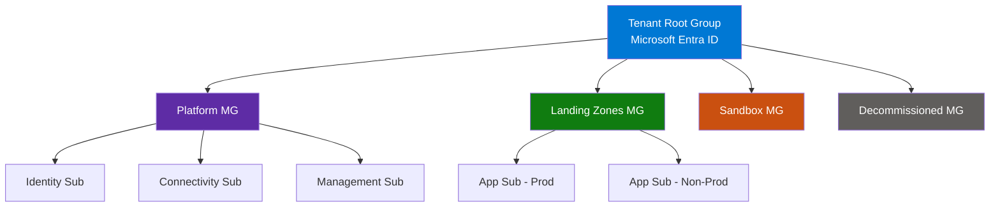
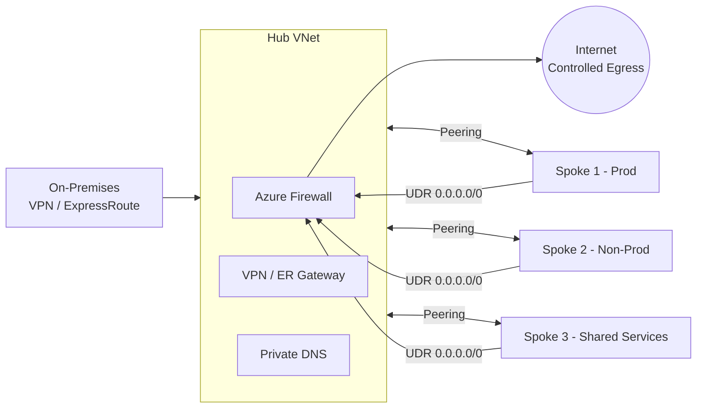
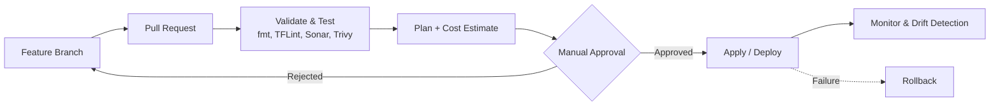

<!-- Header banner -->

  
  
  
  

---

## 👋 About Me

I'm a **Senior DevSecOps Engineer** with **9+ years of IT experience** — including **6+ years in Cloud, DevOps and DevSecOps** — currently at **AmeriCloud**, Hyderabad.

I started in **telecom and networking** (Ericsson, Nokia), moved into **cloud automation**, and today I design **enterprise-grade Azure platforms**: governed tenants, hub-and-spoke networks, Terraform landing zones, and secure CI/CD pipelines. That networking foundation is why my cloud designs are strong on connectivity, security and reliability.

> 💡 **My engineering philosophy:** *Everything as code. Security shifted left. Governance by default. Automate the boring so people can focus on the hard.*

| | |
|---|---|
| 🔭 **Focus** | Azure Landing Zones, Terraform automation, DevSecOps, Cloud Governance |
| 🎯 **Impact** | Cut infrastructure provisioning time by **80%** with Terraform automation |
| 🤝 **Leadership** | Technical lead mindset: vendor management, KT sessions, team upskilling |
| 📬 **Open to** | Collaboration on Azure, Terraform and DevSecOps topics |

---

## 🛠️ Tech Stack

**☁️ Cloud & Infrastructure**

**🔁 CI/CD & DevOps**

**📦 Containers & Orchestration**

**🔐 Security & DevSecOps**

**📊 Monitoring & Observability**

**💻 OS & Scripting**

---

## 🏛️ What I Do: Enterprise Azure Platform Engineering

### 1️⃣ Tenant & Management Group Hierarchy (Governance)
Designing a clean, scalable governance foundation on **Microsoft Entra ID** and Azure.

- Tenant root group with **Platform**, **Sandbox** and **Decommissioned** management groups
- Subscription boundaries: **platform subscriptions** (identity, connectivity, management) vs **application subscriptions**
- **Azure Policy & Initiatives** assignments at management group scope
- **RBAC group formation** with least-privilege access
- **Subscription onboarding & offboarding** process
- **Policy exemptions** with documented justification and expiry
- Identity & access governance: user management, group management, **Defender for Cloud**, Policy

### 2️⃣ Cloud Adoption Framework (CAF) Strategy
Aligning cloud programs to the **Microsoft CAF** lifecycle: **Strategy → Plan → Ready → Adopt → Govern → Secure → Manage**.

### 3️⃣ Hub-and-Spoke Networking
- **IP address management**, CIDR planning and **on-premises CIDR assessment** to avoid overlaps
- **Hub VNet** following best practices, with **spoke VNets via peering**
- **Centralized inspection** (Azure Firewall), **shared connectivity**, **controlled egress**
- **UDRs**, firewall rules, **Private DNS zones**, **Private Endpoints**
- **VPN Gateway** and **ExpressRoute** for hybrid connectivity

### 4️⃣ Defense in Depth: Security at Every Layer
| Layer | Controls |
|---|---|
| 🪪 **Identity** | Entra ID, RBAC, least privilege, group-based access |
| 🌐 **Networking** | Hub firewall, NSGs, UDRs, Private Endpoints, Private DNS |
| 📜 **Governance** | Management groups, Azure Policy, initiatives, exemptions |
| 🖥️ **Compute** | Hardened images, Defender, patching, vulnerability management |

### 5️⃣ Terraform Landing Zone Automation
- **Remote state** with **least-privilege access** to state files and **encryption at rest**
- **Reusable modules** with versioning
- Pipeline quality gates: **linting (TFLint)**, **secret scanning**, **security scanning**, **testing**, **cost estimation**
- **Manual approvals** before apply
- **Drift detection** using scheduled pipelines

### 6️⃣ Azure Repos & DevSecOps Pipelines
- **Trunk-based** branching with short-lived feature branches
- Branch policies: **PR mandatory**, no delete on `main`, **CODEOWNERS**, minimum reviewers
- Reusable **pipeline templates**: `Validate & Test` → `Build` → `Deploy` → `Apply` → `Rollback`
- **Parallel jobs** for faster feedback

### 7️⃣ Cloud Migrations
Migration strategies, **assessment, discovery and readiness**, pre-checklists, **cutover**, post-checklists and **hypercare**, with structured checklists before, during and after each cutover.

### 8️⃣ FinOps & Cost Optimization
Hunting **idle resources**, **unattached disks** and **oversized VMs**; trimming unnecessary **log ingestion**; **auto-shutdown/start** schedules; **reserved capacity**; and right-sized **backup retention**.

### 9️⃣ Backup, DR & High Availability
**LRS / ZRS / GRS** storage choices, **VMSS**, primary and secondary region design, driven by clear **RTO / RPO** targets.

### 🔟 Monitoring & Observability
**Azure Monitor**, **Log Analytics**, alerting, plus **Prometheus & Grafana** for Kubernetes workloads.

---

## 🤝 Technical Leadership & Vendor Management

Beyond hands-on engineering, I operate as a **technical lead**:

- **Vendor management:** technical task assignment, **SOW**, **RFP / RFI**, technical evaluation matrix, commercial proposals, escalation matrix
- **Delivery governance:** scope, deliverables, acceptance criteria, sprints, dependencies, risks, accountability, payment milestones as per contract
- **Cadence:** weekly reviews, retro calls, deliverable sign-off
- **Transitions:** knowledge transfer, documentation handover, **RACI**
- **People:** team management, upskilling strategy, infra and application initiatives, senior-level interviews and KT sessions

---

## 💼 Experience

| Period | Role | Company |
|---|---|---|
| **May 2024 – Present** | Senior DevSecOps Engineer | **AmeriCloud**, Hyderabad |
| Mar 2022 – May 2024 | DevOps & Security Engineer | CEMtics Solution, Gurgaon |
| Apr 2021 – Feb 2022 | Cloud & Automation Engineer | Ericsson Global India |
| Sep 2018 – Apr 2021 | Network & IT Support Engineer | Ericsson India |
| Feb 2017 – Sep 2018 | Network Engineer | Nokia (Rajasthan) / Teleysia Network |

### 🏆 Highlights
- ⚡ **80% faster** infrastructure provisioning through Terraform automation
- 🔁 Consistent deployments across **Dev, UAT and Production**
- 🔐 Stronger security posture through **RBAC** and pipeline security validation
- 🚀 Faster, more reliable releases through CI/CD automation
- ☁️ Contributed to cloud migration and infrastructure modernization initiatives

---

## 📌 Featured Projects

| Project | Stack | What it covers |
|---|---|---|
| **Azure Infrastructure Automation** | Terraform, Azure, Linux, Git | Modular IaC for VNets, subnets, NSGs, storage and Linux VMs, with remote state and CI/CD integration |
| **Secure CI/CD Pipeline** | Azure DevOps, GitHub, Terraform, SonarQube | Automated pipelines with code quality and security validation gates |
| **Kubernetes Application Deployment** | Docker, AKS, ACR | Containerized apps, deployments, scaling and monitoring on AKS |

---

## 📊 GitHub Stats

---

## 🎓 Education & Certification

- 🎓 **B.Tech**, Electronics & Communication Engineering
- ☁️ **AWS Cloud**, Ethans Tech (ISO Certified), Jan 2021

---

## 🌱 Currently

- 🔨 Building reusable Terraform modules and Azure landing zone patterns
- 📚 Deepening DevSecOps automation and platform governance
- 🧭 Sharing real-world cloud engineering lessons

---

## 📫 Let's Connect

*"Automate everything. Secure by default. Govern at scale."* ☁️

